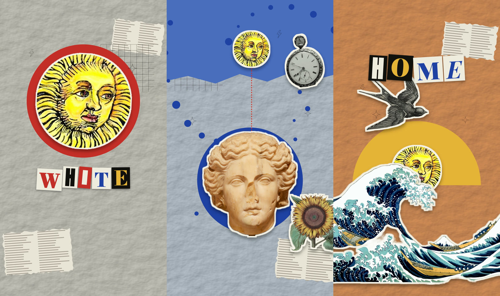

# Collage: paper-collage explainer videos with Claude Code

A free skill for Claude Code. Give it a topic or a script and it makes a paper-collage explainer, with every
piece animated in code. Two looks:

- **Engraving reel** (new in v2): vertical 9:16, synced to your voice. Old engravings with white sticker edges,
  words cut out of magazines letter by letter, crumpled paper, red / blue / yellow paper shapes. Every piece
  lands on the word that names it. Example: `examples/sunset` ("Why sunsets are orange").
- **Vox-style film**: 16:9, black-and-white photo cutouts with red sticker borders, torn paper, old maps,
  label tags, marker circles and an eye-dive transition.

No paid tools and no API keys. It runs on [HyperFrames](https://github.com/heygen-com/hyperframes)
(open source, Apache-2.0), ffmpeg, and public-domain pieces from Wikimedia Commons.



## Install

In Claude Code, paste this repo's link and say:

```
install this skill
```

Or by hand:

```bash
git clone https://github.com/prakhar2603/collage-skill ~/.claude/skills/collage
cd ~/.claude/skills/collage/tools && npm install
swiftc -O lift.swift -o lift        # macOS only
```

You need Node 20+, ffmpeg and Google Chrome.

## Use

```
/collage why are sunsets orange?
```

For a vertical reel, record your voice (or let it make a free AI voice), then:

```
/collage make a vertical engraving reel from voice.wav
```

Claude writes or uses your script, gets word timings from your voice, finds public-domain engravings, cuts
them out, animates every piece in code in time with your words, renders the MP4 and tells you where it is.
Paste the lines from CREDITS.txt into your caption.

To edit it afterwards on a timeline:

```bash
npx -y hyperframes@0.8.33 preview .
```

## What is in here

| Path | What it does |
| --- | --- |
| `SKILL.md` | The instructions Claude follows. |
| `kit/collage-kit.mjs` | The look and the motion: sticker-border filter, torn paper, tags, stamps, 3D titles, halftone, and the timeline helpers. |
| `kit/ransom-kit.mjs` | The engraving reel look: crumpled paper, sticker cutouts, ransom-letter words, paper shapes, newspaper scraps, doodles. |
| `tools/photos.mjs` | Searches Wikimedia Commons, downloads only reusable licences, writes `CREDITS.txt`. |
| `tools/lift.swift` | Cuts the subject out of a photo with the Mac's built-in "lift subject". |
| `tools/cutout.mjs` | Cuts a print or scan off its white paper, with ffmpeg only. |
| `tools/map.mjs` | Flat yellow-and-blue maps from Natural Earth data. No country borders unless you ask for them. |
| `tools/sheet.sh` | Contact sheets, so Claude looks at every photo and cutout before using it. |
| `tools/sfx.sh` | Makes the paper sound effects with ffmpeg. |
| `tools/mix.mjs` | Adds the sounds (and your voice, with `--voice`) to the render. |
| `examples/sunset/` | A complete 19-second vertical engraving reel, timed from `transcript.json`. |
| `examples/dabbawalas/` | A complete 15-second Vox-style film to copy from. |

## Good to know

- **Best on a Mac.** The cutout tool is macOS only. On Windows and Linux the skill falls back to a cutout
  model that is good on people and weak on objects, so objects get framed as photos instead.
- **Credits.** Many Commons photos need attribution. Paste the generated `CREDITS.txt` into your caption or
  description.
- **Facts.** The skill takes every number and name from the Wikipedia article and lists them in `FACTS.md`.
  Check them before you post.
- **Maps have no country borders by default.** The border data shows disputed regions in ways that are wrong
  or illegal to publish in some countries, India included.
- **It takes about 15 minutes** from the prompt to a finished video on a recent Mac.
- **Your voice drives the timing.** HyperFrames transcribes it on your machine and every piece is timed to
  the words. No voice? It can make one locally with Kokoro (`pip install kokoro-onnx soundfile` once).
- **Music is not included.** The video comes with paper sound effects; add your own track.

## Licence

MIT for the code in this repo. Photos in `examples/` keep their own licences (see the `CREDITS.txt` there).
The eye photo in `kit/eye.jpg` is "Iris of the Human Eye" by Mcorrens, CC BY-SA 3.0, via Wikimedia Commons.
